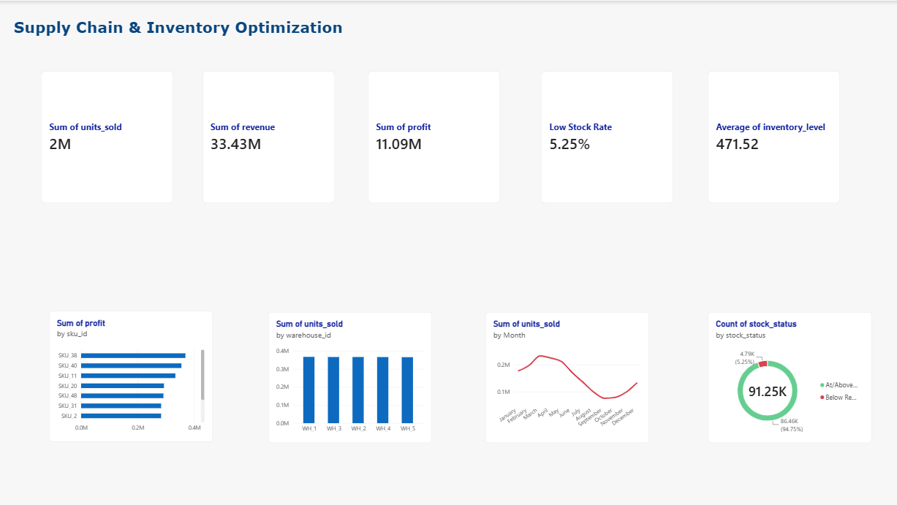
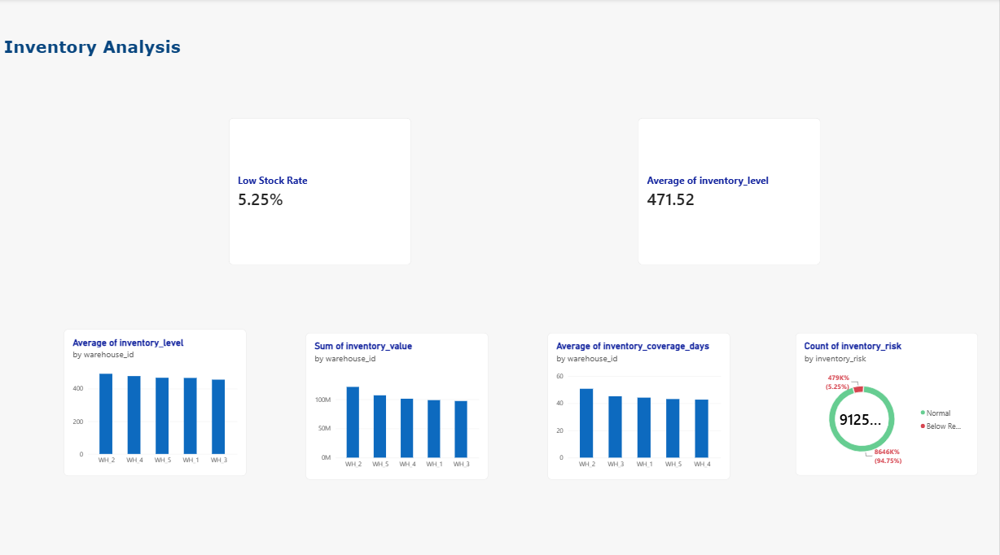
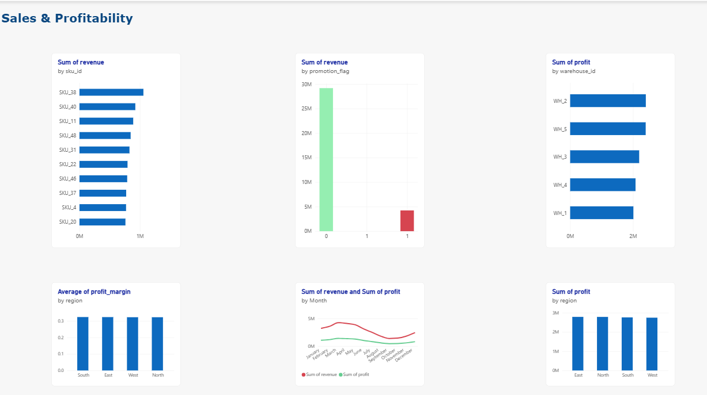
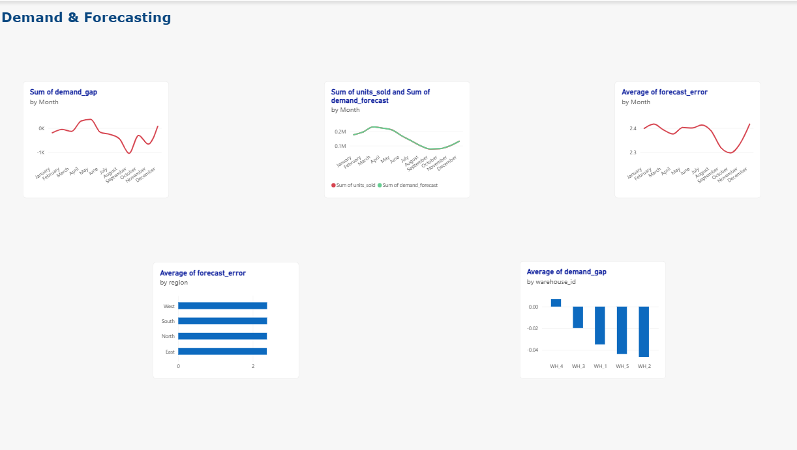
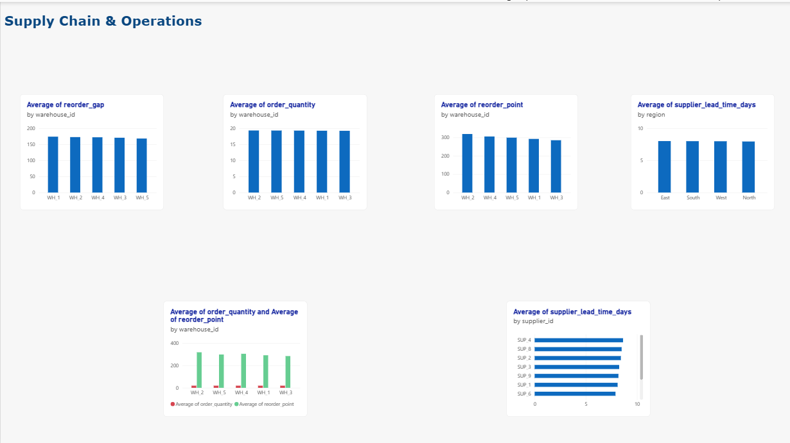
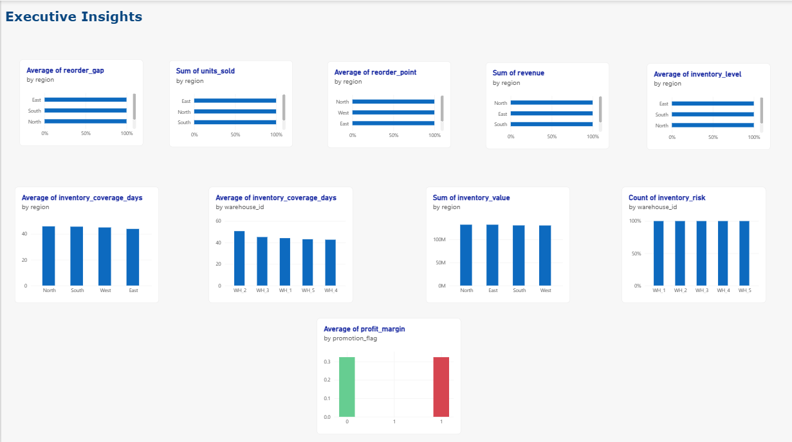

# Supply Chain Inventory Optimization

## Project Overview

This project is an end-to-end data analysis project focused on **supply chain performance, inventory management, demand forecasting, and operational efficiency**.

The objective is to transform raw supply chain data into actionable business insights using **Python, PostgreSQL, SQL, and Power BI**.

The project follows a complete data analysis workflow, from data cleaning and preparation to database analysis, KPI development, interactive visualization, and business recommendations.

## Business Problem

Efficient inventory and supply chain management requires a good understanding of demand, stock levels, supplier performance, profitability, and operational risks.

This project analyzes these areas to answer key business questions such as:

* How are sales, revenue, and profit evolving?
* Which warehouses have higher inventory levels or inventory risks?
* Where are stock levels insufficient?
* How well does forecasted demand match actual demand?
* Which regions and warehouses generate the most revenue and profit?
* How do supplier lead times vary?
* How do reorder points and order quantities compare?
* Where can inventory and operational performance be improved?

## Objectives

The main objectives of this project are to:

* Clean and prepare the raw supply chain dataset.
* Perform exploratory and business-oriented data analysis.
* Store and analyze the data using PostgreSQL.
* Develop SQL analyses and business KPIs.
* Analyze inventory, sales, profitability, demand, forecasting, and supply chain operations.
* Build an interactive Power BI dashboard.
* Identify important business insights from the data.
* Translate analytical findings into practical recommendations.

## Dataset

The project uses a supply chain dataset containing information about sales, inventory, suppliers, warehouses, demand forecasts, costs, and profitability.

After data cleaning and feature engineering, the final dataset contains:

* **91,250 rows**
* **25 columns**

The main variables include:

* Product and operational identifiers: `sku_id`, `warehouse_id`, `supplier_id`
* Geographic information: `region`
* Sales and demand: `units_sold`, `demand_forecast`, `demand_gap`
* Inventory: `inventory_level`, `inventory_value`, `inventory_coverage_days`
* Supply chain: `supplier_lead_time_days`, `reorder_point`, `order_quantity`, `reorder_gap`
* Financial metrics: `unit_cost`, `unit_price`, `revenue`, `cost_of_goods_sold`, `profit`, `profit_margin`
* Risk indicators: `stockout_flag`, `inventory_risk`
* Forecasting metrics: `forecast_error`
* Promotion information: `promotion_flag`

## Data Preparation

The data preparation process was performed using **Python and Pandas** in Jupyter Notebook.

The main steps included:

1. Loading and inspecting the raw dataset.
2. Checking the structure, data types, and data quality.
3. Handling missing and inconsistent values.
4. Converting and standardizing relevant data types.
5. Checking for duplicated records.
6. Creating additional analytical features.
7. Calculating business metrics related to inventory, demand, forecasting, and profitability.
8. Validating the resulting dataset.
9. Exporting the processed dataset for further analysis.

The main derived variables include:

* `revenue`
* `cost_of_goods_sold`
* `profit`
* `profit_margin`
* `inventory_value`
* `demand_gap`
* `forecast_error`
* `inventory_coverage_days`
* `reorder_gap`
* `inventory_risk`

The cleaned and processed dataset was then used for the **PostgreSQL database, SQL analysis, and Power BI dashboard**.

## Database & SQL Analysis

After data preparation, the processed dataset was imported into a **PostgreSQL database** for structured storage and business analysis.

### Database

* **Database:** `supply_chain_db`
* **Table:** `supply_chain`
* **Database system:** PostgreSQL

The database contains the cleaned and engineered supply chain dataset and serves as the main source for the SQL analysis and Power BI dashboard.

### SQL Analysis

The SQL work was organized into three scripts:

#### `01_database_setup.sql`

This script handles the database and table setup required to store the processed supply chain data.

#### `02_business_analysis.sql`

This script focuses on business-oriented analysis, including areas such as:

* Sales performance
* Revenue and profitability
* Inventory levels
* Warehouse performance
* Supplier performance
* Demand and forecasting
* Supply chain operations

#### `03_kpi_analysis.sql`

This script focuses on calculating and analyzing key performance indicators (KPIs) used to evaluate supply chain performance.

The SQL analysis was used to identify patterns and performance differences across **regions, warehouses, suppliers, products, and time periods**.

The results of the SQL analysis were then used as a foundation for the Power BI dashboard and the final business insights.

## Power BI Dashboard

An interactive Power BI dashboard was developed to provide a comprehensive view of supply chain and inventory performance.

The dashboard is organized into **six analytical pages**, each focusing on a specific business area.

### 1. Overview

Provides a high-level view of the overall supply chain performance.

Key indicators and analyses include:

* Total Sales
* Total Revenue
* Total Profit
* Average Inventory
* Low Stock Rate
* Units Sold by Month
* Units Sold by Warehouse
* Top 10 SKU by Profit
* Stock Status Distribution

---

### 2. Inventory Analysis

Focuses on inventory levels, inventory value, coverage, and risk.

Key analyses include:

* Average Inventory Level by Warehouse
* Inventory Risk Distribution
* Average Inventory Coverage Days by Warehouse
* Total Inventory Value by Warehouse

---

### 3. Sales & Profitability

Analyzes sales performance and profitability across regions, warehouses, products, and promotion status.

Key analyses include:

* Total Profit by Region
* Revenue & Profit by Month
* Average Profit Margin by Region
* Top 10 SKU by Revenue
* Total Revenue by Promotion Status
* Total Profit by Warehouse

---

### 4. Demand & Forecasting

Analyzes actual demand, forecasted demand, demand gaps, and forecast errors.

Key analyses include:

* Actual Demand vs Forecast by Month
* Demand Gap by Month
* Average Forecast Error by Region
* Average Demand Gap by Warehouse
* Average Forecast Error by Month

---

### 5. Supply Chain & Operations

Focuses on operational performance related to suppliers, reorder points, lead times, and order quantities.

Key analyses include:

* Average Supplier Lead Time by Supplier
* Average Reorder Gap by Warehouse
* Average Order Quantity by Warehouse
* Average Supplier Lead Time by Region
* Average Reorder Point by Warehouse
* Average Order Quantity vs Reorder Point by Warehouse

---

### 6. Executive Insights

Provides a consolidated view of important supply chain indicators for management-level analysis.

Key analyses include:

* Inventory Risk Distribution by Warehouse
* Average Inventory Coverage Days by Warehouse
* Average Profit Margin by Promotion Status
* Average Inventory Coverage Days by Region
* Total Inventory Value by Region
* Average Reorder Gap by Region
* Total Revenue by Region
* Average Inventory Level by Region
* Average Reorder Point by Region
* Total Units Sold by Region

### Power BI File

The complete Power BI report is available in:

`powerbi/Supply_Chain_Inventory_Optimization1.pbix`

## Key Business Insights

The analysis identified several important supply chain and inventory patterns:

* **Inventory risk:** 94.76% of records are classified as Normal, while 5.24% are Below Reorder Point.
* **Inventory coverage:** records Below Reorder Point have an average coverage of **15.96 days**, compared with **46.77 days** for Normal records.
* **Demand:** the average demand forecast is **24.57 units** for Below Reorder Point records, compared with **19.83 units** for Normal records.
* **Warehouse performance:** WH_2 has the highest average inventory level at **491.49 units** and the highest average inventory coverage at **50.65 days**.
* **Regional profitability:** average profit margins remain relatively consistent across regions, ranging from **32.33% to 32.45%**.
* **Forecasting:** the average forecast error is **2.38** across all four regions.
* **Supplier lead time:** average supplier lead time ranges from **6.76 days in WH_5** to **8.48 days in WH_4**.

These findings highlight the importance of monitoring inventory coverage, reorder points, demand forecasts, and supplier lead times together rather than analyzing each indicator independently.

For detailed analysis and recommendations, see [`reports/business_insights.md`](reports/business_insights.md).

